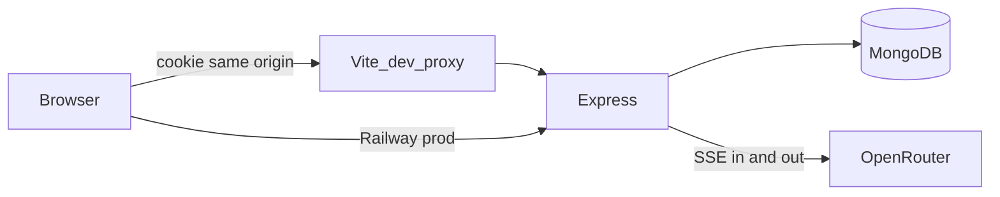
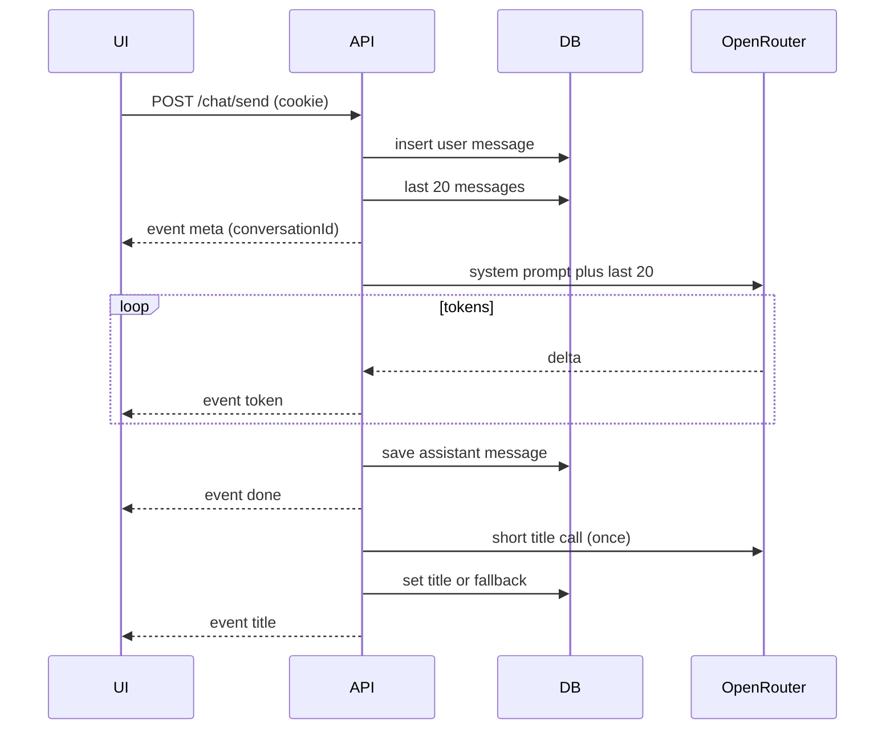
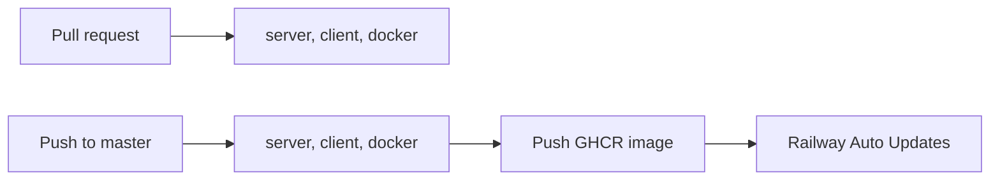

# Lumen Ledger support chat

A small AI customer-support chat. People sign up, then talk to Nora, who answers only about Lumen Ledger. Replies stream over server-sent events, and each person's conversations are saved.

Live demo: [https://viral-chat-production.up.railway.app/](https://viral-chat-production.up.railway.app/)

[](https://github.com/Sad7920/viral-chat/actions/workflows/ci.yml)

## Features

- Email and password sign-up and login, with an httpOnly session cookie
- Separate conversations, a sidebar, and cursor pagination
- Token streaming, markdown replies, copy, and a Stop button
- Model picker limited to a server allowlist
- Escalation stored on the conversation (nothing is emailed)
- Delete conversation, light and dark theme, toasts, and skeleton loaders

## Stack

Node 26, Express 5, Mongoose, Zod, Vite, React, TypeScript, and Tailwind CSS. MongoDB Atlas holds the data. OpenRouter generates replies. The production process is one container on Railway, built in GitHub Actions and stored on GHCR.

## Architecture



In development the browser talks only to Vite on port 5173. Vite proxies `/auth`, `/chat`, `/persona`, and `/models` to Express. In production Express serves the built client and the API on one origin.

The cookie is httpOnly, SameSite=Lax, Secure in production, and Path=/. JavaScript cannot read it. An XSS bug could still call the API with the cookie. It could not copy the token out.



## Run locally

Create an Atlas cluster and a database user that can read and write one database. Under Network Access, allow your current IP. Copy `server/.env.example` to `server/.env` (that file stays untracked) and set `MONGODB_URI`, `JWT_SECRET` (at least 32 characters), and `OPENROUTER_API_KEY`. Leave `OPENROUTER_MODEL` on an id from `server/src/allowlist.js`.

Install the Node major in `.nvmrc` (`nvm use`). From the repository root, with [Colima](https://github.com/abiosoft/colima) providing the Docker daemon:

```sh
colima start
docker compose up --build
```

The client is at http://localhost:5173 and the API is at http://localhost:4000. Compose loads `server/.env.example`, then `server/.env` when that file exists, so the Atlas URI replaces the Compose Mongo URI. The Compose `mongo` service is still there, which lets the stack boot from the example file alone.

Colima's file share does not deliver filesystem events into the Linux VM, so a Mac bind mount would not refresh Vite. `server.watch.usePolling` is on for that reason. `server.host` is true so the dev server is reachable outside the container.

## Environment

| Name | Where | Purpose |
| --- | --- | --- |
| `NODE_ENV` | server | `development`, `test`, or `production` |
| `PORT` | server | HTTP port, default 4000 |
| `MONGODB_URI` | server | Atlas connection string. The example points at Compose Mongo |
| `JWT_SECRET` | server | HS256 secret, at least 32 characters. The example value is refused in production |
| `OPENROUTER_API_KEY` | server | OpenRouter key. The server refuses to boot if it is empty |
| `OPENROUTER_MODEL` | server | Default model id. Must be on the allowlist or the server refuses to boot |
| `CLIENT_ORIGIN` | server | Browser origin allowed by CORS. Production is the public Railway URL |
| `VITE_PROXY_TARGET` | client | Dev proxy only. Default `http://localhost:4000`. Compose sets `http://server:4000` |

`server/.env.example` and `client/.env.example` list every variable. Do not commit a filled-in `.env`.

## Seed

Development only. The live site uses real sign-ups. From a running Compose stack:

```sh
docker compose exec server npm run seed
```

This recreates `demo@lumen.test` with password `demo-pass-dev-only`, labelled here because it is development only. The script refuses to run when `NODE_ENV=production`. It is idempotent: it deletes that user's previous conversations and writes a spread of support threads, one long markdown thread, one incomplete reply, and one escalation.

## Swap the persona or domain

Brand copy lives only in `server/src/persona.js` (`agentName`, `companyName`, `greeting`, `suggestedPrompts`, `titleInstruction`, `systemPrompt`). Edit that file, restart the server, and reload. No client strings change. Model ids and labels live in `server/src/allowlist.js`. `OPENROUTER_MODEL` has to be one of those ids.

## API

Errors are `{ "error": "..." }` with status 400, 401, 404, 429, or 502. No stack traces. A missing or someone else's conversation is 404.

| Method | Path | Auth | Notes |
| --- | --- | --- | --- |
| `POST` | `/auth/signup` | no | `{ email, password }`, 201, sets the cookie |
| `POST` | `/auth/login` | no | Same body. Unknown email and wrong password share one 401 |
| `POST` | `/auth/logout` | cookie | Clears the cookie |
| `GET` | `/auth/me` | cookie | `{ id, email }` or 401 |
| `GET` | `/persona` | no | Public brand fields. Never the system prompt |
| `GET` | `/models` | no | Allowlist and the default model id |
| `GET` | `/chat/history` | cookie | `?limit&cursor`. `{ items, nextCursor, hasMore }` |
| `GET` | `/chat/conversations/:id/messages` | cookie | Newest page first, same cursor shape |
| `POST` | `/chat/send` | cookie | SSE. Body `{ conversationId, content, model? }` |
| `POST` | `/chat/conversations/:id/retry` | cookie | SSE. Re-runs the last unanswered or incomplete turn |
| `POST` | `/chat/conversations/:id/escalate` | cookie | `{ summary }`. A second call is 400 |
| `DELETE` | `/chat/conversations/:id` | cookie | Deletes messages, then the conversation |

Send and retry respond with `Content-Type: text/event-stream`. Each event is two lines and a blank line:

```
event: token
data: {"text":"Hello"}

```

| Event | Data |
| --- | --- |
| `meta` | `{ "conversationId" }` |
| `token` | `{ "text" }` |
| `done` | `{ "messageId", "incomplete" }` |
| `title` | `{ "title" }` |
| `error` | `{ "message" }` |

## Tests

In `server/`: `npm run lint`, `npm run format:check`, and `npm test` (`node:test` against an in-memory MongoDB, with OpenRouter stubbed).

In `client/`: `npm run lint`, `npm run typecheck`, `npm run format:check`, `npm test` (Vitest for the SSE parser and list helpers), and `npm run build`.

Tests never call OpenRouter.

## CI/CD

Pull requests run the server, client, and docker jobs. The docker job builds the `prod` target and does not push. A superseded pull request run is cancelled.

A push to `master` runs those same checks. After they pass, `publish` pushes `ghcr.io/sad7920/viral-chat:latest` and `:sha-<short commit>` for `linux/amd64`. A master run is not cancelled mid-publish. CI does not call Railway.



## Deployment

The running app is the public image `ghcr.io/sad7920/viral-chat:latest` on one Railway service. Railway does not build the Dockerfile. Auto Updates watch `latest` and roll the service forward when the image changes.

**Deploy latency.** Railway caches registry digests, so Auto Updates can take up to a few hours. For an immediate update, click Redeploy on the service in the Railway dashboard. The free-tier service may sleep when idle, so the first request after a pause is slow.

Railway service variables, by name: `MONGODB_URI`, `JWT_SECRET`, `OPENROUTER_API_KEY`, `OPENROUTER_MODEL`, `CLIENT_ORIGIN`, `NODE_ENV`. `CLIENT_ORIGIN` is `https://viral-chat-production.up.railway.app`. `NODE_ENV` is `production`.

Production uses its own Atlas project. Railway Hobby egress addresses are not stable, so that project's network access is `0.0.0.0/0`. The database user is scoped to this one database and uses a strong password. The dev cluster stays limited to a developer IP.

To roll back, point the Railway service image at an older tag, for example `ghcr.io/sad7920/viral-chat:sha-abc1234`. The auth and send rate limiters keep their counts in memory, one set per instance, so a second replica would not share them.

## Manual persona checklist

Run these against a live model before calling the persona done:

- Nora stays in character as Lumen Ledger support.
- An off-topic question gets one short refusal and a redirect back to billing help.
- She never invents a balance, an invoice number, or a payment status.
- She mentions the Escalate button and that humans are available weekdays, 9 to 17 US Eastern.
- The system prompt never appears in the UI or in the stored history.

## Design decisions

**Cookie, not localStorage.** The session is an httpOnly cookie, so page scripts cannot read the token. localStorage would expose it to any script on the page. SameSite=Lax on a single origin is the CSRF control. There is no separate CSRF token.

**Cursor, not offset.** History and messages page with a cursor of `{ time, id }`. A new row at the top does not shift an older cursor, so a walk does not skip or repeat. Offset pagination does both when the list changes.

**fetch streaming, not EventSource.** Send is a POST with a JSON body. `EventSource` only does GET. `fetch` returns a readable body the client can parse as SSE, and `AbortController` cancels it.

**Partial save on disconnect.** When the response closes early, the server aborts the OpenRouter request and stores whatever text arrived, marked incomplete. Closing the tab, switching chats, and Stop all take that path.

**Stop is an abort.** The button aborts the browser fetch. There is no stop endpoint. The server sees a closed response and keeps the partial reply.

## Troubleshooting

**Atlas IP allowlist.** If the server exits while connecting, Network Access on the dev cluster does not include your current IP. Add it. The production project is the one opened to `0.0.0.0/0`.

**Colima DNS.** If the server container cannot resolve the Atlas hostname, restart the VM with a public resolver:

```sh
colima stop
colima start --dns 1.1.1.1
```
