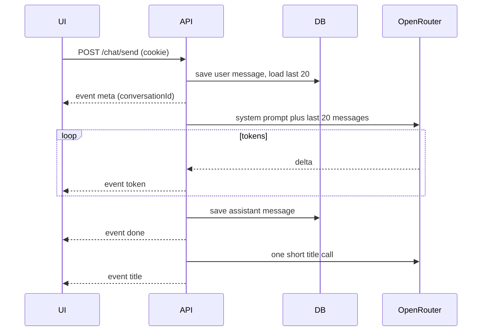

# Lumen Ledger support chat

An AI customer-support chat. Users sign up, log in and talk to **Nora**, a support agent for a fictional company (Lumen Ledger). Replies stream in token by token, and every user's conversations are saved and can be reopened later.

**Live demo:** [https://viral-chat-production.up.railway.app/](https://viral-chat-production.up.railway.app/)   [CI](https://github.com/Sad7920/viral-chat/actions/workflows/ci.yml)

The demo runs on a free tier, so the first request after a quiet period can be slow. Sign up with any email and a password of 8 or more characters.

## Try it

- Ask "My Friday payout hasn't arrived". Nora explains plans and payouts, and never invents balances or invoice numbers.
- Ask something off-topic. She gives one short redirect back to billing help.
- Press **Stop** mid-reply, switch the model, or click **Escalate** to attach a summary for a human.
- Start a few chats, then use the sidebar to reopen them. Older chats and older messages load as you scroll.

## What the brief asked for, and where it is

| Brief                                         | Implementation                                                                                                                                     |
| --------------------------------------------- | -------------------------------------------------------------------------------------------------------------------------------------------------- |
| JWT auth, bcrypt, protected routes            | Signup, login and logout. bcrypt (cost 12). JWT in an httpOnly cookie. `requireAuth` middleware on the server and protected routes on the client   |
| Chat, user-scoped history, past conversations | MongoDB with Mongoose. Every query filters by `userId`. Sidebar of conversations with cursor pagination and scroll-up paging for older messages    |
| AI integration                                | OpenRouter. The server holds a model allowlist and the user picks one in the top bar. Nora's persona is a system prompt in `server/src/persona.js` |
| Endpoints                                     | `POST /auth/signup`, `POST /auth/login`, `POST /chat/send` (streams over SSE), `GET /chat/history`                                                 |
| React chat UI                                 | Vite, React, TypeScript, Tailwind CSS and shadcn/ui. `fetch` with an SSE reader, no Axios                                                          |
| Docker                                        | `docker compose up --build`                                                                                                                        |
| Hosting                                       | Railway (container image from GHCR) and MongoDB Atlas                                                                                              |
| Bonus                                         | Typing indicator, rate limiting with `express-rate-limit` (auth per IP, chat per user), and dev/prod config switching through `NODE_ENV`           |
| Deliverables                                  | `client/` and `server/`, `.env.example` in both, this README, the live link                                                                        |

Also included: markdown replies, copy message, Stop button, AI-generated conversation titles, delete conversation, escalation, light and dark theme, toasts and skeleton loaders.

## Run locally

```sh
cp server/.env.example server/.env   # then set OPENROUTER_API_KEY
docker compose up --build

```

The client is at [http://localhost:5173](http://localhost:5173) and the API is at [http://localhost:4000](http://localhost:4000). Compose loads `server/.env.example` first and `server/.env` on top, so the only value you must set is `OPENROUTER_API_KEY`. The stack uses the bundled Mongo container by default. To use Atlas instead, set `MONGODB_URI` in `server/.env` and allow your IP under Atlas Network Access (if the server exits while connecting, that is usually the cause).

To load demo data: `docker compose exec server npm run seed`. It creates `demo@lumen.test` with password `demo-pass-dev-only` plus about 60 sample conversations. It is for development only and refuses to run when `NODE_ENV=production`.

## Environment (server)

| Name                 | Purpose                                                                                                                                                     |
| -------------------- | ----------------------------------------------------------------------------------------------------------------------------------------------------------- |
| `NODE_ENV`           | `development`, `test` or `production`. Production sets the `Secure` cookie flag, serves the built client from Express, and refuses the example `JWT_SECRET` |
| `PORT`               | HTTP port, default 4000                                                                                                                                     |
| `MONGODB_URI`        | MongoDB connection string. The example points at the Compose Mongo                                                                                          |
| `JWT_SECRET`         | HS256 secret, at least 32 characters                                                                                                                        |
| `OPENROUTER_API_KEY` | OpenRouter key. The server refuses to boot without it                                                                                                       |
| `OPENROUTER_MODEL`   | Default model id. It must be on the allowlist in `server/src/allowlist.js`                                                                                  |
| `CLIENT_ORIGIN`      | Browser origin allowed by CORS (the public URL in production)                                                                                               |

Variables are validated with zod at boot, and the server exits with a readable error if any are wrong. Never commit a filled-in `.env`.

## Architecture

In development the browser talks only to Vite, which proxies `/auth`, `/chat`, `/persona` and `/models` to Express. In production one Express process serves the built client and the API on a single origin. The cookie is httpOnly, SameSite=Lax and Path=/, so scripts cannot read the token.



## API

Errors are `{ "error": "..." }` with status 400, 401, 404, 429 or 502. A missing or someone else's conversation is always 404.

| Method   | Path                                          | Notes                                                                  |
| -------- | --------------------------------------------- | ---------------------------------------------------------------------- |
| `POST`   | `/auth/signup`, `/auth/login`, `/auth/logout` | Body `{ email, password }`. The first two set the cookie               |
| `GET`    | `/auth/me`                                    | `{ id, email }` or 401                                                 |
| `GET`    | `/persona`, `/models`                         | Public. Brand fields (never the system prompt) and the model allowlist |
| `GET`    | `/chat/history`                               | `?limit&cursor` returns `{ items, nextCursor, hasMore }`               |
| `GET`    | `/chat/conversations/:id/messages`            | Newest page first, same cursor shape                                   |
| `POST`   | `/chat/send`                                  | SSE. Body `{ conversationId, content, model? }`                        |
| `POST`   | `/chat/conversations/:id/retry`               | SSE. Re-runs the last unanswered or incomplete reply                   |
| `POST`   | `/chat/conversations/:id/escalate`            | `{ summary }`. A second call is 400                                    |
| `DELETE` | `/chat/conversations/:id`                     | Deletes the messages, then the conversation                            |

SSE events are `meta { conversationId }`, `token { text }`, `done { messageId, incomplete }`, `title { title }` and `error { message }`.

## Change the persona

All brand copy lives in `server/src/persona.js` (name, company, greeting, example prompts, system prompt). Edit it, restart the server and reload. No client code changes. Model ids live in `server/src/allowlist.js`.

## Tests

- `server/`: `npm test` runs `node:test` against an in-memory MongoDB with OpenRouter stubbed. It covers auth, ownership, pagination, streaming, partial saves and rate limits.
- `client/`: `npm test` runs Vitest on the SSE parser and list helpers. `npm run typecheck` and `npm run build` also run in CI.

Tests never call OpenRouter.

## CI/CD and deployment

Pull requests run lint, format check, typecheck, tests, a client build and a Docker build of the production image. A push to `master` runs the same checks, then publishes `ghcr.io/sad7920/viral-chat:latest` and a `:sha-<commit>` tag for `linux/amd64`.

Railway runs that image and rolls forward through its Auto Updates, which can take a few hours because Railway caches registry digests. The Redeploy button in the Railway dashboard applies it immediately. To roll back, point the service at an older `sha-` tag.

Railway service variables, by name: `MONGODB_URI` (a separate Atlas project from development), `JWT_SECRET`, `OPENROUTER_API_KEY`, `OPENROUTER_MODEL`, `CLIENT_ORIGIN`, `NODE_ENV=production`. The rate limiters keep their counts in memory, one set per instance.

## Design decisions

- **Cookie, not localStorage.** An httpOnly cookie keeps the token out of reach of page scripts. SameSite=Lax on a single origin is the CSRF control.
- **Cursor, not offset pagination.** A new row at the top never shifts an older cursor, so pages don't skip or repeat.
- `fetch` **streaming, not** `EventSource`**.** Sending a message is a POST, and `EventSource` only does GET.
- **Stop is an abort.** The browser cancels the request, the server aborts the OpenRouter call and saves the partial reply as incomplete. Closing the tab or switching chats take the same path.
