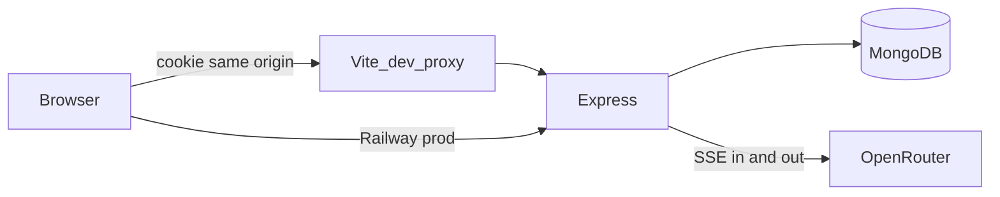
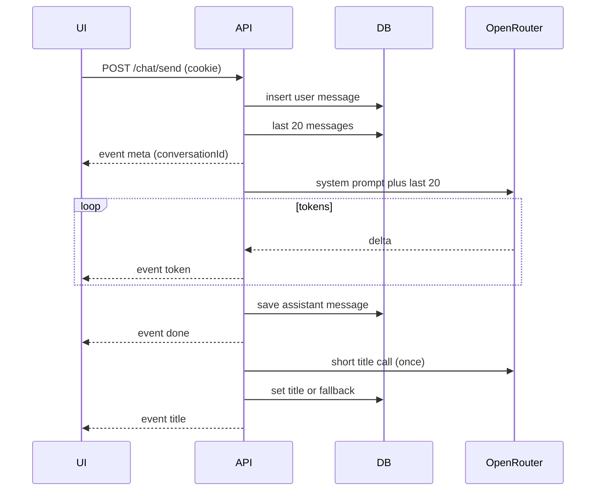

# Lumen Ledger Support Chat: specification

This is the only spec for the project. UI details live in `docs/design/DESIGN.md`. If a milestone prompt and this file disagree, stop and tell me before building.

## 1. What we are building

A minimal AI customer support chat app. Users sign up, log in and chat with Nora, a support agent for a fictional company, Lumen Ledger. Replies stream token by token over SSE. Conversations are saved per user and load lazily.

The code must be production-grade and small enough that I can explain every file in an interview.

Deliverables: a GitHub repo with `client/` and `server/`, `.env.example` in both, a clear README, a deployed link, and `docker compose up` working offline.

## 2. Locked decisions

Product

- Separate conversations with a sidebar. On mobile the sidebar is a drawer. The empty state shows the agent, the company, the greeting and three example prompts.
- Company Lumen Ledger, agent Nora. Swapping the company means editing one server file.
- Light and dark theme with a toggle. First visit follows the system. No background changer, no gradients.
- Models are allowlisted on the server. The user picks one in the top bar.
- Escalation is a top-bar button that opens a dialog. It stores `{ summary, createdAt }` on the conversation. Nothing is emailed.
- Conversation titles are generated by the model once, with a fallback.
- Included features: copy message, assistant markdown, delete conversation, Stop button, toasts, skeleton loaders.

Auth

- httpOnly cookie. Same origin in dev (Vite proxy) and in prod (Railway serves the built client). No CSRF token: SameSite=Lax on a single origin is the control.
- Cookie lifetime 7 days. Signup logs the user in. Email and password only. Password minimum 8 characters. bcrypt cost 12.

Engineering

- Client: Vite, React, TypeScript (strict), Tailwind CSS v4, shadcn/ui, `fetch` (no Axios).
- Server: Node (current LTS), ESM JavaScript, Express 5, Mongoose with thin schemas (fields, timestamps, indexes, `select: false` on `passwordHash`; no plugins, virtuals or hooks), zod validation.
- Database: Docker Compose Mongo for offline use. A local untracked env file may point at Atlas dev. Railway uses a separate Atlas prod project.
- Tooling: ESLint and Prettier in both packages, Vitest for pure client functions, `node:test` with `mongodb-memory-server` for the server, GitHub Actions CI.

Out of scope (do not build): Helmet, a health route, graceful shutdown, structured logging (pino), refresh tokens, conversation search, end-to-end browser tests, a background changer, Axios, a repository or store layer.

## 3. Architecture



Dev: the browser talks only to Vite on localhost:5173. Vite proxies /auth, /chat, /persona and /models to Express. Prod: one Railway service, one origin; Express serves `client/dist` and the API.

The cookie is httpOnly, SameSite=Lax, Secure in production, Path=/. JavaScript cannot read it. Residual risk to state in an interview: an XSS bug could still call the API with the cookie, but it cannot exfiltrate the token.



## 4. Folder structure

```
.github/workflows/ci.yml
.nvmrc, .prettierrc, .prettierignore, .gitignore, .dockerignore
Dockerfile, docker-compose.yml, README.md
docs/SPEC.md, docs/design/DESIGN.md

server/
  package.json, eslint.config.js, .env.example
  scripts/seed.js
  src/index.js            connect and listen
  src/app.js              Express factory createApp({ env, openrouter, limits })
  src/env.js              zod; refuse to boot if invalid
  src/db.js               mongoose.connect
  src/persona.js          the only brand file
  src/allowlist.js        OpenRouter model allowlist
  src/cursor.js           cursor encode/decode
  src/openrouter.js       streaming and one-shot calls
  src/sse.js              writes SSE events
  src/models/User.js, Conversation.js, Message.js
  src/middleware/auth.js, error.js
  src/routes/auth.js, chat.js, persona.js   (persona.js serves /persona and /models)
  test/                   node:test files

client/
  package.json, eslint.config.js, tsconfig*.json, vite.config.ts, components.json, index.html, .env.example
  src/main.tsx, App.tsx, api.ts, sse.ts, auth.tsx, index.css
  src/lib/utils.ts, lists.ts
  src/pages/Login.tsx, Signup.tsx, Chat.tsx
  src/components/Sidebar.tsx, Thread.tsx, Composer.tsx, Message.tsx,
                 StatusBadge.tsx, Callout.tsx, ThemeProvider.tsx, ThemeToggle.tsx
  src/components/ui/      shadcn: button input textarea label card dialog sheet sonner skeleton
  src/hooks/useChatStream.ts   (optional, only if it keeps components readable)
  src/**/*.test.ts        Vitest, pure functions only

```

Server dependencies: express, mongoose, bcrypt, jsonwebtoken, cookie-parser, zod, cors, dotenv, express-rate-limit (added in the bonus milestone only). Dev: mongodb-memory-server, eslint, prettier. Client dependencies: react, react-dom, react-router-dom, react-markdown, tailwindcss, @tailwindcss/vite, tw-animate-css, class-variance-authority, clsx, tailwind-merge, lucide-react, sonner, Fontsource packages. Dev: typescript, vitest, eslint, prettier.

## 5. Environment variables

NODE_ENV, PORT (default 4000), MONGODB_URI, JWT_SECRET (min 32 chars; in production the placeholder from `.env.example` is refused), OPENROUTER_API_KEY (non-empty), OPENROUTER_MODEL (must be on the allowlist or the server refuses to boot), CLIENT_ORIGIN. Client: VITE_PROXY_TARGET (default http://localhost:4000, used only by the dev proxy).

`server/.env.example` points at the Compose Mongo (`mongodb://mongo:27017/lumen`) so `docker compose up` works without Atlas. Secrets in the example are obvious placeholders.

## 6. Data model

users: `_id`, `email` (unique index), `passwordHash` (select: false), `createdAt`.

conversations: `_id`, `userId`, `title` (string, starts as "New chat"), `escalation` (null or `{ summary, createdAt }`), `createdAt`, `updatedAt`. Index: `{ userId: 1, updatedAt: -1, _id: -1 }`.

messages: `_id`, `conversationId`, `userId`, `role` (user or assistant), `content`, `model` (assistant only), `incomplete` (boolean), `createdAt`. Index: `{ conversationId: 1, createdAt: -1, _id: -1 }`.

Indexes are declared with `schema.index(...)`, and `Model.init()` is awaited at boot so they exist before the server listens. The system prompt is never a message. Ownership is part of the query (`userId` in the filter), never a check after the fact. Routes call the models directly.

## 7. Cursor pagination

Cursor is base64url of `{ t, id }`. Sort is the index order. The next page is strictly older than the cursor (time, then `_id` on a tie). The handler fetches `limit + 1` and returns `hasMore`. Every paginated response has this shape:

`{ items, nextCursor, hasMore }`

An empty history is `{ items: [], nextCursor: null, hasMore: false }`. A malformed cursor is a 400. A new row inserted at the head does not shift an older cursor, which is why this is cursor-based rather than offset-based.

Limits (zod coerce): history default 20, messages default 30, max 50.

## 8. API

All input is zod-validated. Errors are `{ error: string }` with status 400, 401, 404, 429 or 502. No stack traces.

Auth

- `POST /auth/signup { email, password }`: 201, sets the cookie. Email trimmed and lowercased. Password 8 to 72 characters (bcrypt ignores bytes past 72). Duplicate email is 400 "Email already in use".
- `POST /auth/login { email, password }`: 200, sets the cookie. Wrong password and unknown email return the identical 401 "Invalid email or password"; for an unknown email still compare against a dummy hash so timing doesn't leak.
- `POST /auth/logout`: clears the cookie.
- `GET /auth/me`: `{ id, email }` or 401.
- Cookie `token`: JWT HS256 `{ sub: userId }`, 7 day expiry, httpOnly, SameSite=Lax, Path=/, Secure only in production, maxAge 7 days. CORS is `cors({ origin: CLIENT_ORIGIN, credentials: true })`.

Public

- `GET /persona`: `{ agentName, companyName, greeting, suggestedPrompts }`. Never the system prompt or title instruction.
- `GET /models`: `{ models: [{ id, label }], defaultModel }` from the allowlist.

Protected (requireAuth on all)

- `GET /chat/history?limit&cursor`: sidebar list. Items `{ id, title, escalation, updatedAt }`.
- `GET /chat/conversations/:id/messages?limit&cursor`: newest page first. Items `{ id, role, content, model, incomplete, createdAt }`.
- `POST /chat/send` (SSE): body `{ conversationId: string | null, content (1 to 4000, trimmed), model? }`.
- `POST /chat/conversations/:id/retry` (SSE): re-runs the last user message.
- `POST /chat/conversations/:id/escalate { summary }`: summary 1 to 500 chars. A second call is 400 "Already escalated".
- `DELETE /chat/conversations/:id`: deletes the messages first, then the conversation.

A malformed or not-owned id is always 404. `model` must be on the allowlist (400 otherwise); omitted means `OPENROUTER_MODEL`.

## 9. SSE and the model context

Headers: `Content-Type: text/event-stream`, `Cache-Control: no-cache, no-transform`, `X-Accel-Buffering: no`, `flushHeaders()`, write each event immediately. No compression middleware.

Events: `meta { conversationId }`, `token { text }`, `done { messageId, incomplete }`, `title { title }`, `error { message }`.

Context sent to OpenRouter on every call, including retries and trimmed threads: `[{ role: "system", content: persona.systemPrompt }, ...last 20 user/assistant messages in chronological order]`. UI pages are not the context window. Reasoning deltas from the model are dropped; only `delta.content` is used.

Client disconnect (tab closed, chat switched, Stop pressed): detect with `res.on("close")` and `res.writableFinished` (not `req`), abort the upstream request, and save any partial text with `incomplete: true`.

Failures

- Before the first token: emit `error`, keep the user message, save no assistant row.
- After tokens: save what arrived with `incomplete: true`, then emit `error`.
- An upstream 429 becomes the message "The model is rate limited right now. Try again shortly."
- Other upstream failures before streaming starts are 502 `{ error }`.

Retry: if the last message is an incomplete assistant row, delete it and re-run. If the last message is a user message (nothing was answered), re-run it. If the last message is a complete assistant reply, 400 "Nothing to retry". Never insert a second user message.

Title: only while the conversation title is still "New chat". After the first assistant reply is saved complete, make one non-streaming call on the same model with `persona.titleInstruction` plus the first exchange (`max_tokens` about 30), save it and emit `title`. If the call fails, or the first reply was incomplete, set the first 48 characters of the user message instead, with no second request. Never retry. The title call does not use the full support prompt.

## 10. Persona

`server/src/persona.js` exports `agentName`, `companyName`, `greeting`, `suggestedPrompts`, `titleInstruction`, `systemPrompt`.

- agentName "Nora", companyName "Lumen Ledger".
- greeting: "I'm Nora. I can help with invoices, payouts, subscriptions, and failed payments. I can't see your account, so I won't guess balances or invoice numbers."
- suggestedPrompts: "My Friday payout hasn't arrived", "My card payment failed", "How do I change from Starter to Studio?"

Nora is calm, brief and plain-spoken. She explains Lumen Ledger only:

- Starter: free, 3 invoices a month, no payouts.
- Studio: $12/month, unlimited invoices, Friday payouts.
- Practice: $29/month, next-business-day payouts.
- Invoices default to net 14.
- A failed card is retried twice over 3 days, then the account becomes read-only.
- She cannot see the account and must never invent balances, invoice numbers or payment status.
- Tax, legal and off-topic requests get one sentence and a redirect to billing help.
- Humans are available weekdays 9 to 17 US Eastern; she points to the Escalate button.

The header, empty state, greeting, example prompts and auth pages render whatever `GET /persona` returns. Swapping the company is an edit to this file and a server restart. No client string changes. No brand string is hard-coded in the client.

Models (`server/src/allowlist.js`, separate from the Mongoose models): Nemotron 3 Ultra (default), ERNIE 5.5 Flash, Nemotron 3.5 Lightning, Ling 3.2 Flash, Nemotron 3.5 Super VL. Confirm the exact `:free` slugs against https://openrouter.ai/api/v1/models before using them, and tell me about any that don't exist.

## 11. Frontend

Routes: `/login`, `/signup`, `/` (chat, protected). `GET /auth/me` on load; a 401 means signed out, not an error. No flash of the wrong page while loading.

Layout: sidebar, top bar (company and agent, model select, Escalate, theme toggle), thread, docked composer. Under `md` (768px) the sidebar is a drawer opened from the top bar. Full visual spec in DESIGN.md.

Sending

- Optimistic user message and an assistant placeholder, both with temp ids. `meta` gives the conversation id (a new conversation appears at the top of the sidebar). `token` appends. `done` swaps in real ids. `title` updates the sidebar row.
- While streaming, the Send button becomes a Stop button. Stop aborts the fetch (AbortController). If text had arrived, keep it and show the warning "Incomplete" badge with Retry. If none had, show a muted "Stopped before a reply" row with Retry.
- After an aborted stream, re-fetch the first history page and upsert rows by id so the sidebar title is correct.
- Switching conversations or leaving the page also aborts the stream. The server saves the partial.
- `error` shows the error row; the rate-limit message shows the amber Callout.

Scroll rules (Thread)

1. The first page scrolls to the bottom.
2. Older pages (30 at a time, loaded when scrolling up) prepend, then restore the `scrollHeight` delta so the view doesn't jump.
3. Tokens stick to the bottom only when the user is already within about 80px of it.
4. Merge by id so nothing duplicates. The in-flight reply uses a temp id until `done`.
5. A failed page shows an inline retry control and leaves the loaded pages in place. Also: never run two page fetches at once, and ignore a response that arrives after the user switched conversations.

Sidebar: conversations load 20 at a time with a "Load more" button, with an inline retry on failure. Each row has a delete button that opens a confirmation Dialog.

Feedback

- Toasts (Sonner) are for non-blocking feedback only: "Copied", a failed delete, a failed escalation. Stream errors and failed pages are inline, never toasts.
- Skeleton loaders appear on the first load of the sidebar list and of a conversation's messages.

Assistant messages render markdown with react-markdown (raw HTML off). Each has a Copy button.

Pure helper functions live in `src/lib/lists.ts` (`upsertById`, `swapId`, `prependOlder`) so they can be unit tested.

## 12. Docker and Colima

One root `Dockerfile` with stages in this order: `dev-client`, `dev-server`, `build-client`, `prod`. `prod` must be last so Railway's default build picks it. Use Debian slim Node images, not Alpine (bcrypt and mongodb-memory-server need glibc). `prod` runs as a non-root user and installs with `npm ci --omit=dev`.

Compose services: `client` (Vite, 5173), `server` (4000), `mongo` (27017, named volume, healthcheck). `server` depends on `mongo` with `service_healthy`. Anonymous volumes over `/app/client/node_modules` and `/app/server/node_modules` so a Mac bind mount doesn't clobber Linux modules. Vite uses `server.host: true` and `server.watch.usePolling: true`. No host network mode.

`env_file`: `server/.env.example` first, then `server/.env` with `required: false` (Compose v2.24 or newer), so a local `.env` pointing at Atlas overrides the example.

Prod: Express serves `client/dist` with an SPA fallback that never answers /auth, /chat, /persona or /models; unknown paths there get the JSON 404.

## 13. Tests

Server (`node:test` against `createApp`, Mongoose connected to `mongodb-memory-server`, OpenRouter stubbed, never a live call)

- Auth: hash stored, cookie flags, login, identical failure responses, duplicate email, validation, `/auth/me`, tampered or expired cookie, logout, `passwordHash` never in a response.
- Ownership: user A cannot read, escalate or delete user B's conversation.
- Cursors: empty page, full walk with no duplicates or gaps, ties on identical timestamps, `hasMore: false` on the last page, a newer row mid-walk does not skip or repeat.
- Send: `messages[0]` is the system prompt; the prompt is absent from stored messages; a second turn and a trimmed context still start with it; failure before and after tokens; abort saves a partial; title fallback; 429 message; allowlist; retry rules.
- `/persona` never leaks the system prompt or title instruction.
- Live persona behaviour (stays in character, refuses off-topic) is a manual README checklist, because a live assertion would be flaky and would spend the free quota.

Client (Vitest, pure functions only, no DOM): the SSE parser and `lists.ts`.

## 14. Tooling and CI

- Prettier config at the repo root (`semi`, double quotes, `trailingComma: "all"`, `printWidth: 100`). ESLint flat config in each package with `eslint-config-prettier`.
- Scripts in both packages: `lint`, `format`, `format:check`. Client also `typecheck` (`tsc -b`) and `test` (`vitest run`). Server has `test` (`node --test`).
- `.nvmrc` at the repo root holds the Node major. The Dockerfile and CI use the same major.
- `.github/workflows/ci.yml`: runs on pull requests and pushes to `main`, `permissions: contents: read`, concurrency cancels superseded runs. Jobs: server (lint, format check, test, with the mongodb-memory-server binary cached), client (lint, typecheck, format check, test, build), docker (build the `prod` target, no push). Pin official actions to their current major versions.

## 15. Seed script (development only)

`server/scripts/seed.js`, run with `docker compose exec server npm run seed`. It refuses to run when `NODE_ENV=production`. It is idempotent: it recreates a demo user (`demo@lumen.test`, password in the script and README, labelled development only), deletes that user's previous conversations and messages, then creates about 60 conversations with realistic support topics and updated times spread over 60 days; one long conversation of 120 or more messages that includes a markdown reply (a list and a code block); one conversation whose last assistant message is `incomplete: true`; and one conversation with an escalation. Replies are written in Nora's voice. If Mongoose overwrites the supplied timestamps, insert through the native collection instead.

## 16. Deployment

Railway: one web service built from the Dockerfile (the `prod` stage is last). Environment: MONGODB_URI, JWT_SECRET, OPENROUTER_API_KEY, OPENROUTER_MODEL, CLIENT_ORIGIN (the public Railway URL), NODE_ENV=production. Atlas prod network access must allow Railway; Hobby egress IPs aren't stable, so the practical rule is 0.0.0.0/0 on that project only, with a database user scoped to this one database and a strong password. Atlas dev can stay limited to my IP. SSE stays unbuffered because the response isn't behind a second proxy and compression is off. In production `trust proxy` is set to 1 (needed for correct per-IP rate limiting).

README sections: what it is, stack, offline Compose setup, Atlas dev override, Colima notes, env variables, how to swap the persona or domain (edit `server/src/persona.js`, restart, reload; model ids live in `server/src/allowlist.js`), seed script, API list with the SSE event format, tests and CI, the manual persona checklist, design decisions for the interview, Railway and Atlas prod steps.

## 17. Risks

- The free model quota (about 20 requests/min, 50/day). A new chat spends two requests (reply and title). A title failure does not retry.
- Nemotron reasoning text must be stripped or the reply fills with chain-of-thought. Confirm the response field against a live call.
- Atlas open to 0.0.0.0/0 on prod is a network exposure; keep the DB user scoped and the password strong.
- No Helmet, no graceful shutdown. A Railway restart can cut a stream; the partial-save path covers a client disconnect, not a process kill mid-write.
- Rate limiting is in-memory and per instance.
- In-character behaviour is enforced by the prompt and checked manually, not by a deterministic test.
- shadcn's Sonner template imports `next-themes`; it must be rewritten to use our own theme hook.